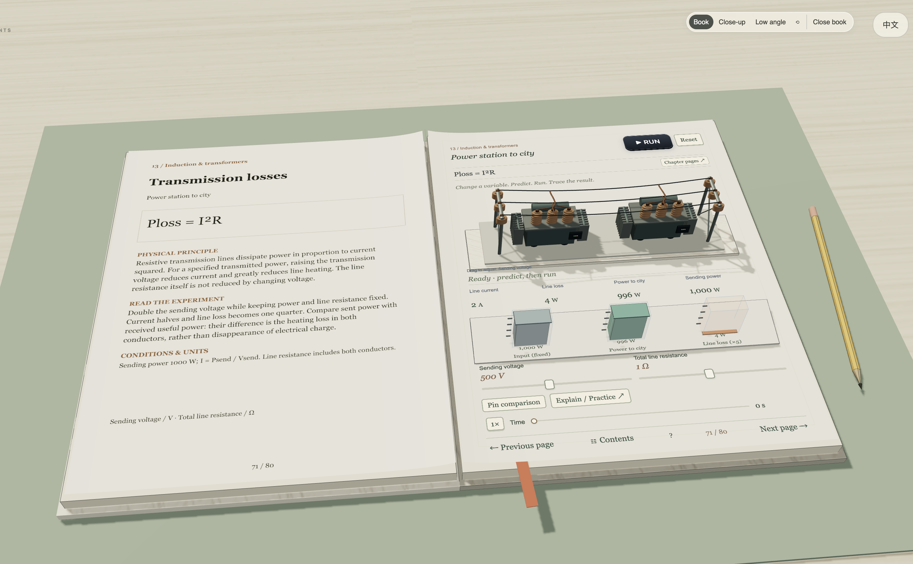

# Helios Physics

> An interactive 3D physics book that turns IGCSE-style physical relationships into tactile, bilingual experiments.

**Live product:** [heliosphysics.com](https://heliosphysics.com)

## About

Helios Physics is a browser-based interactive learning experience spanning 15 physics chapters and 80 formula-led experiment pages. Each spread connects a physical relationship to a manipulable visual model, so learners can observe a system, change a variable, run a trial and relate the result back to the equation.

The live edition supports English and Chinese throughout the book, including its interface, concepts, units, experiment prompts and formula explanations.

Visitors can open the book, browse the complete contents and formula catalogue, and run six full experiments for free. A one-time purchase unlocks personal lifetime access to all 80 experiments, both language editions and future experiments added to the book.

## Experience highlights

- Immersive 3D open-book presentation with an interactive apparatus or scene for every experiment
- Formula-specific demonstrations across mechanics, energy, thermal physics, waves, optics, electricity, nuclear physics and space
- Direct manipulation alongside precise slider controls
- Responsive graphs, force arrows, measurement instruments and animated physical systems
- English / 中文 language switching while preserving the current experiment state
- Passwordless accounts with purchase access linked to the signed-in email account

## Free demonstrations

The six complete demonstrations available without purchase include:

- Force, mass and acceleration — `F = ma`
- Archimedes’ principle — `Fᵇ = ρgV`
- Thermal efficiency — `efficiency = Wᵤˢᵉᶠᵘˡ / Qᵢₙ`
- Potential difference in series — `V = V₁ + V₂`
- Transmission losses — `Pₗₒₛₛ = I²R`
- Expansion time scale — `t ≈ 1 / H₀`

## Technology

- Three.js and WebGL for the spatial book, apparatus, lighting, materials and animation
- Canvas-rendered bilingual lesson pages, labels, graphs and formula layouts
- Vanilla JavaScript modules for simulations, interaction models and interface state
- Node.js services for passwordless accounts and protected access
- Stripe Checkout with signed webhook fulfilment for one-time purchases
- Tencent Cloud hosting and transactional sign-in email delivery

## Preview

## Demonstration video

A recorded walkthrough is in preparation.

## Policies and support

- [Terms of Service](https://heliosphysics.com/legal.html?doc=terms&lang=en)
- [Digital Access & Refund Policy](https://heliosphysics.com/legal.html?doc=refunds&lang=en)
- [AI & Educational Disclaimer](https://heliosphysics.com/legal.html?doc=disclaimer&lang=en)
- [Privacy Notice](https://heliosphysics.com/legal.html?doc=privacy&lang=en)
- [Contact & Support](https://heliosphysics.com/legal.html?doc=contact&lang=en)

## Source availability

This public repository is a portfolio showcase only. It intentionally contains presentation material rather than the implementation, production configuration, protected educational content or source assets. The application source is maintained in a separate private repository.

## Copyright

Copyright © 2026. All rights reserved.

This repository is for portfolio demonstration purposes only. No permission is granted to copy, modify, redistribute or commercially exploit the original project, source code, visual assets or other protected materials without prior written authorisation.
